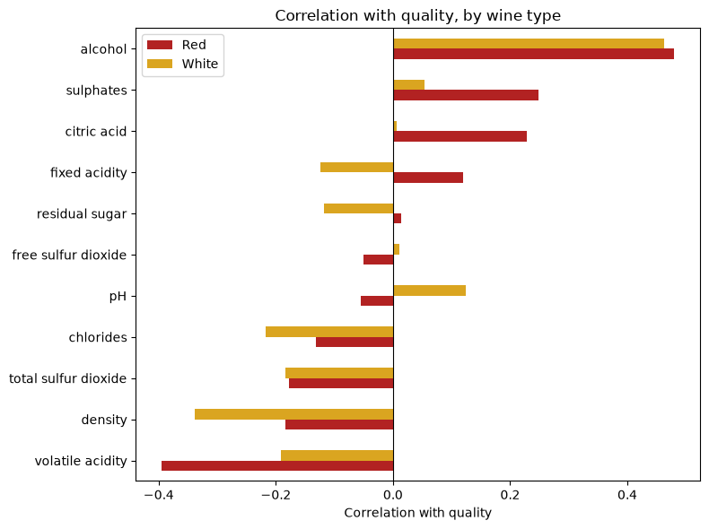
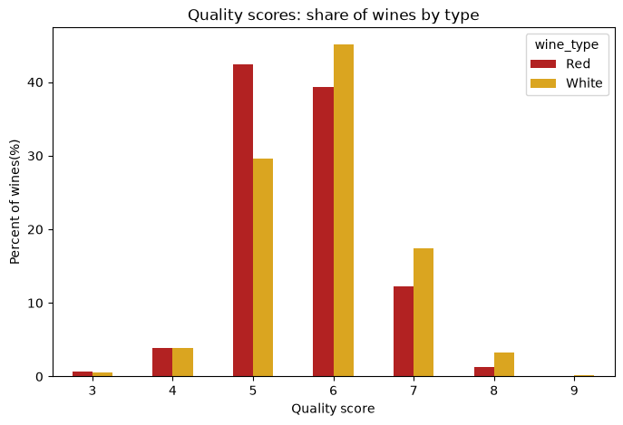
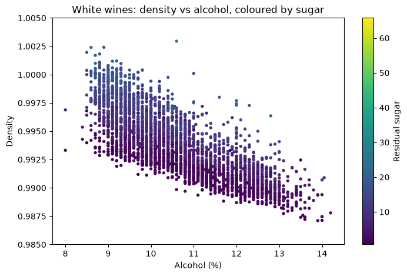

# What Chemistry Tells Us About Wine Quality

Which chemical properties are associated with higher quality scores in red and white wine?

I cleaned and analysed 5,320 Portuguese wines (after removing 1,177 duplicate rows) using Python, pandas, matplotlib and seaborn.

## Key findings

- Alcohol content had the strongest positive link with quality in both red (r = 0.48) and white wines (r = 0.46).
- The next factors differed by type: volatile acidity (r = -0.40) for red, and density (r = -0.34) and chlorides (r = -0.22) for white.
- In white wines, density is closely tied to alcohol and sugar (r = -0.76 and 0.82), so its link to quality may partly reflect them.
- These are correlations, not proof of cause.

## Files

- `wine_quality_analysis.ipynb`: the full analysis notebook
- `wine_quality_analysis.pdf`: PDF version of the notebook
- `data/`: the red and white wine data files
- `images/`: charts used in this page

## How to run it

1. Install the packages: `pip install -r requirements.txt`
2. Open `wine_quality_analysis.ipynb` in JupyterLab
3. Run all cells

## Data source

 "Wine_Quality_Data" by Ghassen Khaled, Kaggle (CC0: Public Domain). Based on the Wine Quality dataset by Cortez et al. (2009), UCI Machine Learning Repository.

## Limitations

Quality scores are subjective ratings by tasters, most wines scored 5 or 6, and the data has no information on grape variety, price or vintage. I did not test whether density adds information beyond alcohol and sugar.

Author: Grace Oladosu